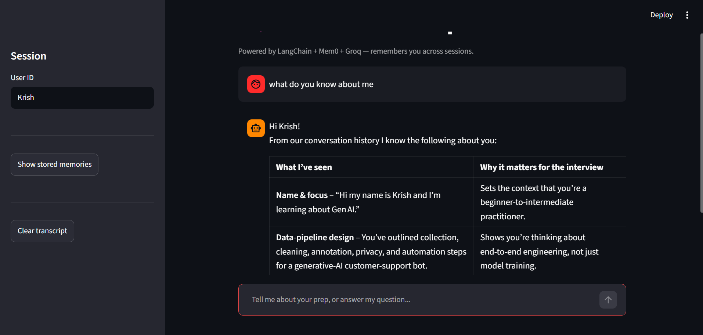
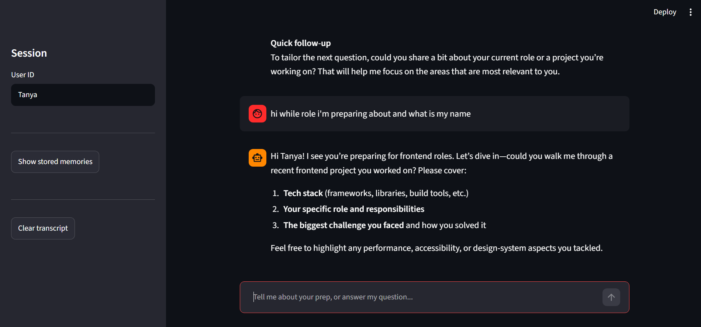

# 🧠 AI Interview Prep Coach

An AI-powered interview preparation assistant built using Python, Streamlit, LangChain, Mem0, Groq, Gemini, and Qdrant.

The project explores how persistent conversational memory can make AI assistants more personalized by retrieving relevant information from previous interactions.

## Features

- **AI-powered chat:** Interact with an LLM through a Streamlit interface.
- **Persistent memory:** Store and retrieve conversation information using Mem0.
- **Semantic search:** Retrieve relevant memories using Gemini embeddings and Qdrant.
- **Context-aware responses:** Use retrieved memories to provide more personalized answers.
- **Memory viewer:** Inspect stored memories associated with a user.
- **LLM integration:** Generate responses using a Groq-hosted language model.

## Tech Stack

- Python
- Streamlit
- LangChain
- Mem0
- Groq
- Google Gemini Embeddings
- Qdrant
- UV

## How It Works

1. The user submits a question through the chat interface.
2. Mem0 retrieves relevant stored memories.
3. LangChain combines the memories with the user's question.
4. The LLM generates a response.
5. The conversation is stored for future retrieval.

## Screenshots

Added screenshots of the application interface and memory viewer in a `screenshot/` folder.





## Run Locally

### Prerequisites

- Python 3.12
- UV
- Groq API key
- Google Gemini API key

### Installation

Clone the repository:

```bash
git clone https://github.com/tanya-181/AI-interview-prep-coach/blob/main/memory_agent.py
cd mem0_live
```

Install dependencies:

```bash
uv sync
```

Create a `.env` file in the project root and add your API credentials:

```dotenv
GROQ_API_KEY=your_groq_api_key
GEMINI_API_KEY=your_gemini_api_key
```

Use the exact environment variable names required by your code. Never commit API keys to GitHub.

Run the application:

```bash
uv run streamlit run app.py
```

## Future Improvements

- Improve memory extraction and deduplication.
- Add role-specific interview preparation.
- Support coding, behavioral, and system-design questions.
- Add automated testing and improved error handling.

## Author

**Tanya Kumari**

GitHub: https://github.com/tanya-181

## Project Repository

https://github.com/tanya-181/AI-interview-prep-coach
